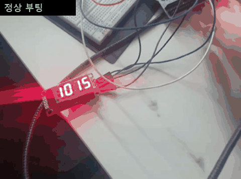
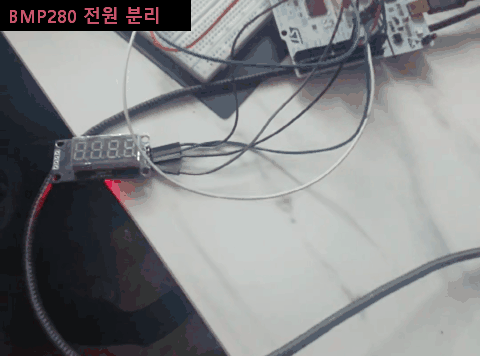

### Sung-woo Lee · Embedded Firmware 👋

**STM32 펌웨어 — 회로부터 펌웨어까지 직접 확인하는 개발자입니다.** 데이터시트와 보드 회로도로 연결을 확인하고, 오실로스코프·멀티미터·디버거 레지스터 값으로 동작을 검증합니다.

---

## 📌 대표 프로젝트

<table>
<tr>
<td colspan="2" valign="top">

**[STM32 환경 센서 모니터](https://github.com/wwsw12/stm32-multi-interface-sensor)**

I2C(BH1750 조도) · SPI(BMP280 기압·온도) · GPIO 비트뱅잉(TM1637) · UART를 한 MCU에 통합한 베어메탈 펌웨어

- 요구사항 검증 **8 / 8 통과** · 고장 주입 시험 **3건**
- SPI 통신 실패를 오실로스코프와 보드 회로도로 추적해 해결

</td>
</tr>
<tr>
<td width="50%" valign="top"> <b>정상</b>: RESET → <code>TEST</code> → <code>GOOD</code> → 기압 <code>1015</code> hPa</td>
<td width="50%" valign="top"> <b>실패</b>: BMP280 전원을 뺀 채 RESET → <code>TEST</code> → <code>ERR</code></td>
</tr>
</table>

<table>
<tr>
<td colspan="2" valign="top">

**[STM32 BLE 양방향 제어 (R/W 프로토콜)](https://github.com/wwsw12/103RB_EVB_BLE_RW_Protocol)**

스마트폰 앱 ↔ HM-10(BLE) ↔ USART1을 STX~ETX 바이너리 패킷으로 연결한 인터럽트 기반 펌웨어

- 센서 **7종 읽기(R)** · 출력 소자 **6종 제어(W)**
- 보드에서 발견한 패킷 수신 버그 **2건** 수정

</td>
</tr>
<tr>
<td width="40%" valign="top"> <b>R</b> (보드 → 앱): 보드 센서를 건드리면 앱 값이 따라 바뀜</td>
<td width="60%" valign="top"> <b>W</b> (앱 → 보드): 앱에서 보낸 값대로 서보·CLCD·RGB LED가 바뀜</td>
</tr>
</table>

<table>
<tr>
<td colspan="2" valign="top">

**[ROKEY 부트캠프 팀 프로젝트 (로봇 · ROS2)](https://github.com/wwsw12/rokey-bootcamp-projects)**

두산로보틱스 ROKEY 부트캠프 5기 팀 프로젝트 **4개** — TurtleBot4 협동 추적, 두산 M0609 핸드드립 · 위병소 경계, Isaac Sim 청소 로봇

- 제 담당: Arduino 로드셀 무게로 추출 단계 전환 · Nav2로 인식 좌표 이동 · 권총 파지용 YOLO 분할 학습
- 코드는 팀 저장소, 이 저장소에는 프로젝트별 목표 · 구성 · 담당 · 시연 정리

</td>
</tr>
<tr>
<td width="33%" valign="top"> <b>BaRo Coffee</b>: 로봇팔 드립 추출</td>
<td width="67%" valign="top"> <b>Two Cops</b>: 로봇이 도주 차량(RC카) 추적</td>
</tr>
</table>

- **AutoC** — 준비 중

## 🛠 기술 스택

| 분야 | 사용 |
|---|---|
| MCU · 펌웨어 | STM32 (F103 · F091 · F429), C, STM32Cube HAL, STM32CubeIDE |
| 통신 | I2C · SPI · UART · BLE (HM-10) |
| 주변장치 | ADC + DMA, 타이머 PWM, EXTI 인터럽트 |
| 측정 · 디버깅 | 오실로스코프, 멀티미터, 디버거 SFR 확인 |
| 회로 | 데이터시트·보드 회로도 분석, KiCad |

## 📫 연락처

- Email: wwsw12@dankook.ac.kr
